# KVMpad

KVMpad turns the **Waveshare ESP32-S3-Touch-LCD-7B** into a touchscreen keyboard and touchpad. Plug its native USB port into the computer you want to control. Type on the 7-inch screen or send input over Wi-Fi from another PC using the Windows CLIENT or SSH.

**Get started.** Install Windows CLIENT on the operator PC. Open **Tools → Board firmware** to prepare the signed 7B image or install it over USB-UART. [Windows x64 test release](https://github.com/D-Ogi/esp32-s3-kvmpad/releases/tag/v0.1.0-preview.1) · [Installation guide](docs/INSTALL.md)

## Screen gallery

These touchscreen views come from the board in the Day theme. The portrait autopilot shows Demo mode. For the Windows CLIENT, see [pairing](#pair-a-windows-client) and [remote keyboard and mouse control](#send-keyboard-and-mouse-input).


| Touchpad above the keyboard | Full keyboard |
| --- | --- |
| [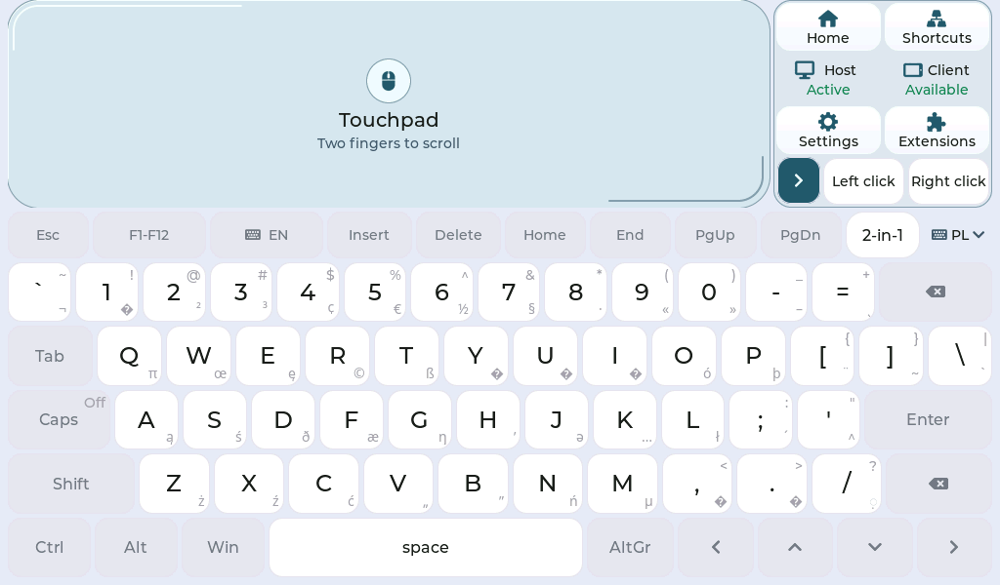](docs/images/day-hybrid.png) | [](docs/images/day-keyboard.png) |
| **System shortcuts** | **Extensions menu** |
| [](docs/images/day-shortcuts.png) | [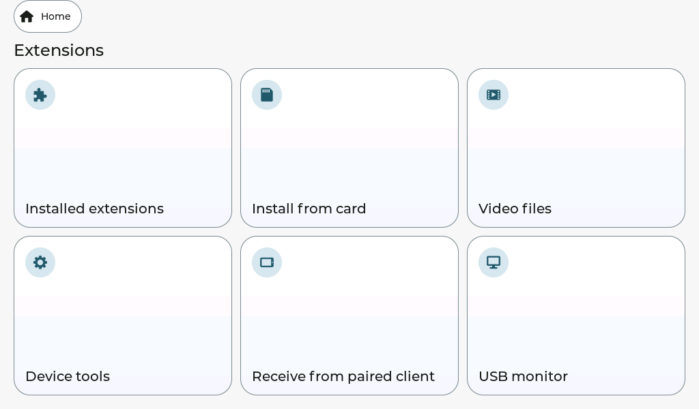](docs/images/day-extensions.png) |
| **Checklist extension** | **Pilot Panel autopilot** |
| [](docs/images/day-checklist.png) | [](docs/images/pilot-autopilot-lcd.png) |

## Use the touchscreen

With the board connected, open **Mouse** to move the pointer, click or scroll. The hybrid keyboard keeps the touchpad within reach while you type. Place it above the keys, on the left or on the right. Hold a finger past the edge of the pad to keep the pointer moving. For a different theme or backlight level, open **Settings → Appearance**.

## Control another computer

**Operator PC → Wi-Fi → KVMpad → USB → target computer**

The **operator PC** is the computer you sit at. The **target** is the computer plugged into KVMpad. Its built-in USB keyboard and mouse drivers handle remote input, so there is nothing to install on the target.

### Pair a Windows CLIENT

Enable remote access on KVMpad. Tap **Pair a client**. On the operator PC, open **KVMpad CLIENT** and select **Discover**.

In this example, CLIENT finds three boards. **A104** has pairing open, **B208** is already paired, and **D416** has pairing closed. The fourth row, **C312**, is a saved device that did not appear in discovery.

| Operator PC · Select KVMpad-A104 | KVMpad · Read its six-digit PIN |
| --- | --- |
| [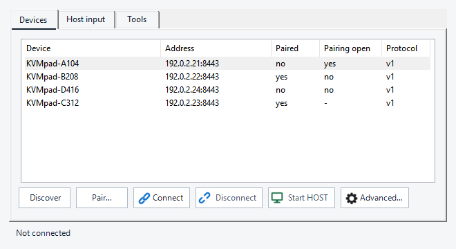](docs/images/client-devices.png) | [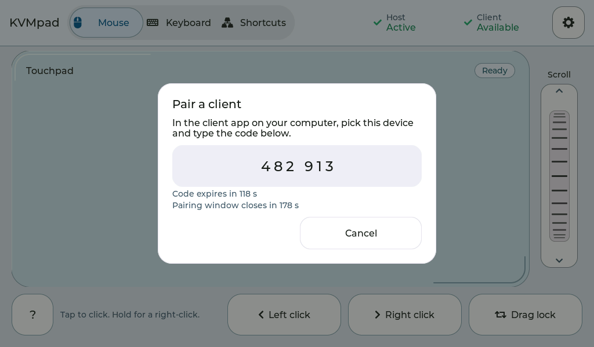](docs/images/pair-pin.png) |
| **Operator PC · Select Pair and enter the PIN** | **KVMpad · Check the computer name and tap Accept** |
| [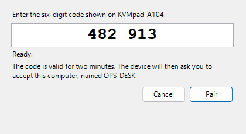](docs/images/client-pair-pin.png) | [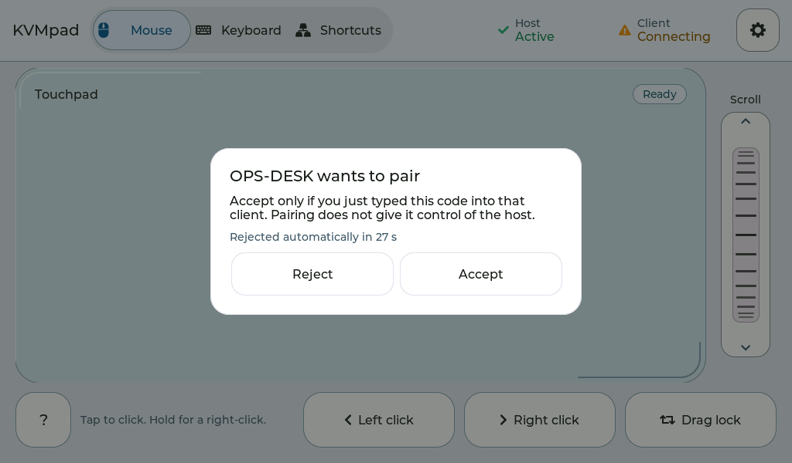](docs/images/pair-accept.png) |

The examples use sample device names and a sample PIN. The touchscreen dialogs use the firmware's LVGL renderer.

### Send keyboard and mouse input

Select the paired board in CLIENT. Select **Connect**. On the **Host input** tab, select **Request control**. When KVMpad asks, check the computer name and tap **Allow**.

| Operator PC · Request control | KVMpad · Allow this session |
| --- | --- |
| [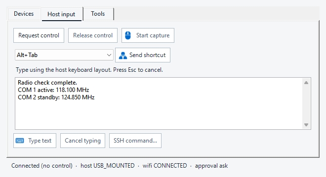](docs/images/client-request.png) | [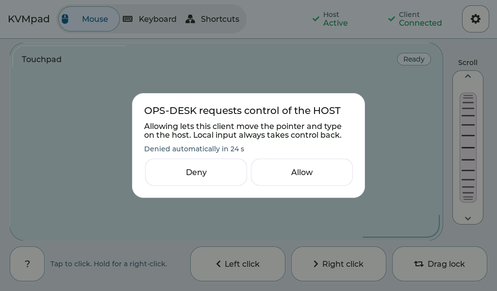](docs/images/control-approval.png) |
| **Operator PC · Send the radio check with Type text** | **Linux target · Read the text in the open editor** |
| [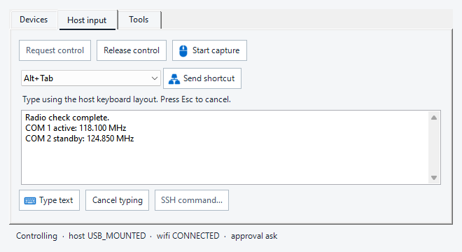](docs/images/client-host-input.png) | [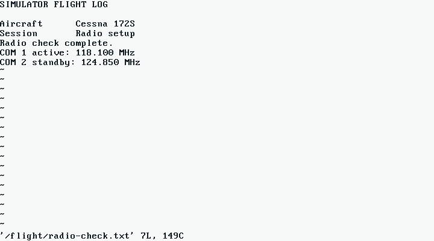](docs/images/target-radio-log.png) |

For a single shortcut, choose **Alt+Tab** and select **Send shortcut**. For direct keyboard and mouse control, select **Start capture**. The default key to stop capture is **Scroll Lock**. Select **Release control** when you finish. The Linux example shows a guest that received the CLIENT keystrokes through a virtual USB keyboard. [Windows CLIENT guide](clients/windows/README.md)

### Switch to another paired device

To control the Windows PC attached to **B208**, release control of **A104**. Select **Disconnect**. In **Devices**, select **KVMpad-B208**. Its **Paired** column shows **yes**, so select **Connect**. Select **Request control**. Approve the session on B208.

| Operator PC · Choose B208 from four devices | Operator PC · Choose a shortcut for the Windows target |
| --- | --- |
| [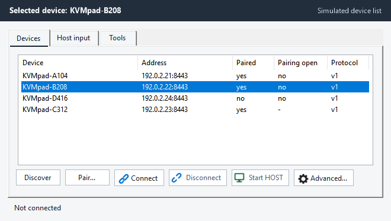](docs/images/client-select-paired.png) | [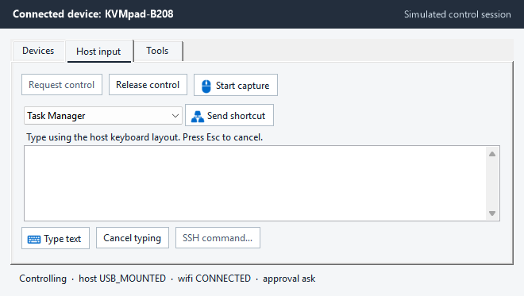](docs/images/client-paired-shortcut.png) |

Select **Send shortcut** to open Task Manager on the target. Both screenshots show the Windows CLIENT with simulated devices.

### Send input through SSH

The **SSH server** runs on KVMpad. It translates commands such as `mouse move 20 0` into USB input for the target. [Command syntax](components/ssh_control/include/ssh_control.h)

1. Select **Host input → SSH command…** in the paired CLIENT.
2. Select your public key. Run the generated command on the operator PC.
3. Approve control on the KVMpad touchscreen. Keep CLIENT connected during the SSH session. [SSH setup](clients/windows/README.md#direct-ssh-input)

## What can I see on the KVMpad screen?

**Cursor Magnifier.** Open the extension on KVMpad. The Windows CLIENT starts **KVMpad HOST** on the PC that runs CLIENT. Select a monitor on that PC. Confirm the selection on KVMpad. HOST sends the area around the pointer to KVMpad over Wi-Fi.

If CLIENT runs on the operator PC, the image comes from the operator PC. To magnify the target computer's desktop, run CLIENT and HOST on that Windows computer. [Cursor Magnifier setup](hosts/windows/README.md)

**An extra USB display (experimental).** The target computer can send a desktop to KVMpad through its USB display driver. The portrait USB Monitor Console combines that desktop with a keyboard and touchpad. Linux requires the GUD driver and manual device setup. We do not recommend the xfz1986 Windows display driver (1.2.25.2). The package uses an untrusted test certificate, and we cannot verify which source code produced the binary. This feature requires a running operating system. [USB compatibility](docs/COMPATIBILITY.md)

**A video from microSD.** Play H.264 clips under **Extensions → Video files**. Playback runs on the board. The Windows CLIENT can prepare clips that exceed the decoder’s available memory. [Prepare a video](clients/windows/README.md#prepare-an-h264-video-for-offline-playback)

## Extensions

Install extensions from a FAT32 or exFAT microSD card using **Extensions → Install from card**. Review the permissions on the touchscreen. In a multi-screen extension, swipe up from the bottom edge to choose another screen or return Home.

**Pilot Panel** includes an offline kneeboard for charts and checklists, plus radio, transponder and autopilot demos. To build your own extension, open **Tools → Extension Studio** in the Windows CLIENT. [Pilot Panel](extensions/pilot-panel/) · [Extension SDK tutorial](tools/extension_sdk/README.md) · [Example packages](tools/kvmpack/examples/)

## Build and development

The 7B runs one firmware image with every target computer. It has a 1024 × 600 display, 16 MiB of flash and 8 MiB of PSRAM. Use the **USB-UART** connector for the development console. [Board details](hardware/boards.md)

- [Build the 7B firmware](docs/HANDBOOK.md#build-the-7b-firmware) with ESP-IDF v6.1, the Xtensa H.264 decoder and an OTA signing key.
- [Run the desktop simulator](simulator/README.md) to try the touchscreen layouts on a computer.
- See the [contribution guide](CONTRIBUTING.md) for the repository layout and test instructions.

## License

KVMpad is source-available under the [PolyForm Noncommercial License 1.0.0](LICENSE.md). Commercial use requires a separate license from the author. Bundled third-party components retain their own licenses. [Third-party notices](THIRD_PARTY_NOTICES.md)

```text
Required Notice: Copyright 2026 D-Ogi (https://github.com/D-Ogi/esp32-s3-kvmpad)
```
