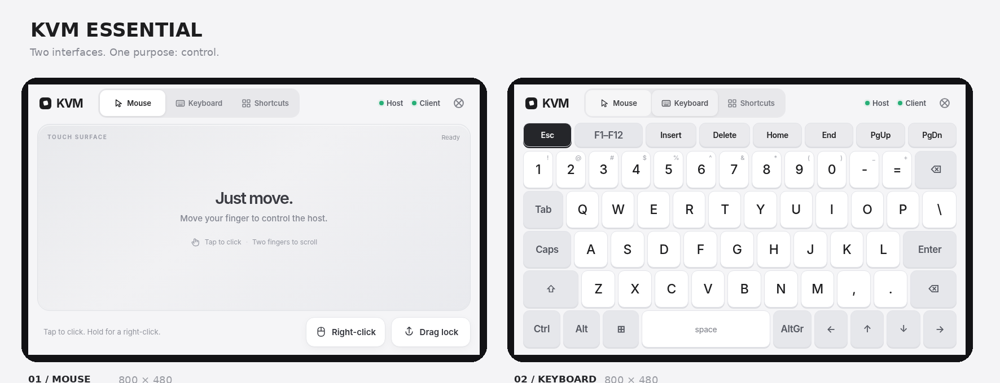

# KVMpad

### ESP32-S3 Touchscreen KVM Controller

**Turn a 7-inch ESP32-S3 touchscreen into a powerful USB keyboard, multi-touch trackpad, and remote KVM control surface.**

KVMpad is a source-available, hardware-based keyboard and mouse controller built for the Waveshare ESP32-S3-Touch-LCD-7 (800×480).

Featuring native USB HID, a gesture-driven multi-touch trackpad, an on-screen keyboard, system shortcuts, and Wi-Fi remote control, KVMpad makes interacting with headless PCs, servers, and development machines simple and intuitive.

**Designed for ESP32-S3. Built with ESP-IDF, LVGL, and TinyUSB.**

> KVMpad provides keyboard and mouse control. It does not capture or stream the host's video output.

**Project status:** Work in progress — firmware under development. The specification (v1.1.0) is complete; no firmware is implemented yet and no hardware tests have been run.



## Hardware

| | |
|---|---|
| Board | Waveshare **ESP32-S3-Touch-LCD-7** (not 7B/7C, not the non-touch version) |
| Display | 7″ 800×480 RGB565, landscape |
| Touch | GT911, 5 points |
| Host link | Native USB OTG → boot keyboard + boot mouse |

## Stack

- ESP-IDF v6.1 · FreeRTOS
- LVGL 9.6 + native Observer + a hand-written **KVMpad UI Core** (no UI generators; see [ADR-014](docs/ADR/ADR-014-no-ui-generators.md))
- `esp_tinyusb` 3.0 (USB HID) · `esp_lcd_touch_gt911`
- Remote path (planned, M7): TLS/WSS, physical pairing approval, ownership leases. Local control never needs Wi-Fi.

Exact versions are pinned in `dependencies.lock` once the first verified build exists (TASK-000).

## Repository layout

```text
components/   firmware components (board_hal, touch_input, gesture_engine, hid_core,
              usb_hid_device, ui_*, remote_protocol, secure_remote, config_store, ...)
main/         app_main
test/         host unit, fuzz, HIL, UI tests and test reports
simulator/    LVGL SDL desktop simulator (800×480)
docs/spec/    full specification v1.1.0
docs/ADR/     architecture decision records
reference/    interactive HTML mockup (UX reference only)
hardware/     measured board records
tools/        helper scripts
```

The full map with dependency rules is in [docs/REPO-LAYOUT.md](docs/REPO-LAYOUT.md).

## Documentation

The specification package v1.1.0 is frozen and verified by a SHA256 manifest (`python -I tools/verify_spec_manifest.py`);
changes are recorded as ADRs in `docs/ADR/`.

| Document | Contents |
|---|---|
| [01 — Functional spec](docs/spec/01-FUNCTIONAL-AND-PROCESS-SPECIFICATION.md) | screens, gestures, keys, statuses, FR/NFR |
| [02 — Technical spec](docs/spec/02-TECHNICAL-SPECIFICATION.md) | board, GPIO, GT911, CH422G, USB HID, LVGL, FreeRTOS, security, OTA |
| [03 — Contracts & protocols](docs/spec/03-CONTRACTS-AND-PROTOCOLS.md) | C contracts, events, state machines, CLIENT protocol |
| [04 — Test plan](docs/spec/04-TEST-PLAN-AND-ACCEPTANCE-CRITERIA.md) | unit, HIL, performance, security, acceptance |
| [05 — Implementation plan](docs/spec/05-IMPLEMENTATION-PLAN.md) | tasks, milestones M0–M9, quality gates |
| [06 — Decisions & risks](docs/spec/06-DECISIONS-AND-RISKS.md) | ADR-001…013, risks |
| [07 — UI architecture](docs/spec/07-KVMpad-UI-FRAMEWORK-ARCHITECTURE.md) | KVMpad UI Core on LVGL 9.6 |
| [AGENTS.md](AGENTS.md) · [AGENTS-UI.md](AGENTS-UI.md) | working contract for contributors |

## Contributing

Read [AGENTS.md](AGENTS.md) first — it applies to every contributor. One PR = one `TASK-xxx`,
with requirement IDs (`FR-`, `TECH-`, `SEC-`) and the tests actually run (`AT-`).
Hardware results without a physical board are always reported as `NOT_RUN_HW`.

## License

KVMpad is **source-available** under the [PolyForm Noncommercial License 1.0.0](LICENSE.md)
(SPDX: `PolyForm-Noncommercial-1.0.0`).

```text
Required Notice: Copyright 2026 D-Ogi (https://github.com/D-Ogi/esp32-s3-kvmpad)
```

- ✅ Personal use, hobby projects, research, education, and use by charitable, educational,
  public-research, public-safety/health, environmental or government organizations.
- ❌ Any commercial use, including selling devices or firmware, needs a separate commercial license from the author.

Third-party components (ESP-IDF, LVGL, TinyUSB, Espressif components) keep their own licenses.
