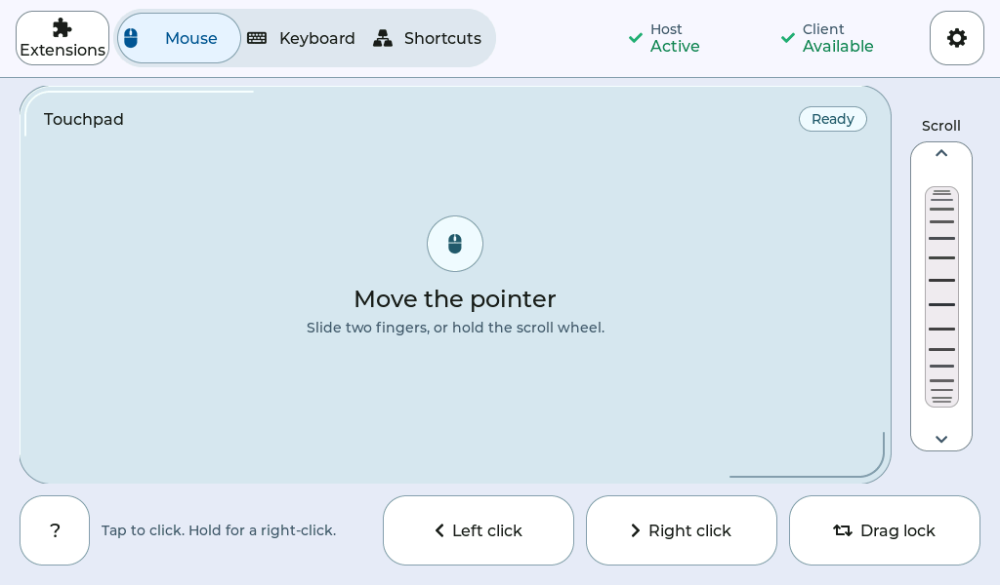
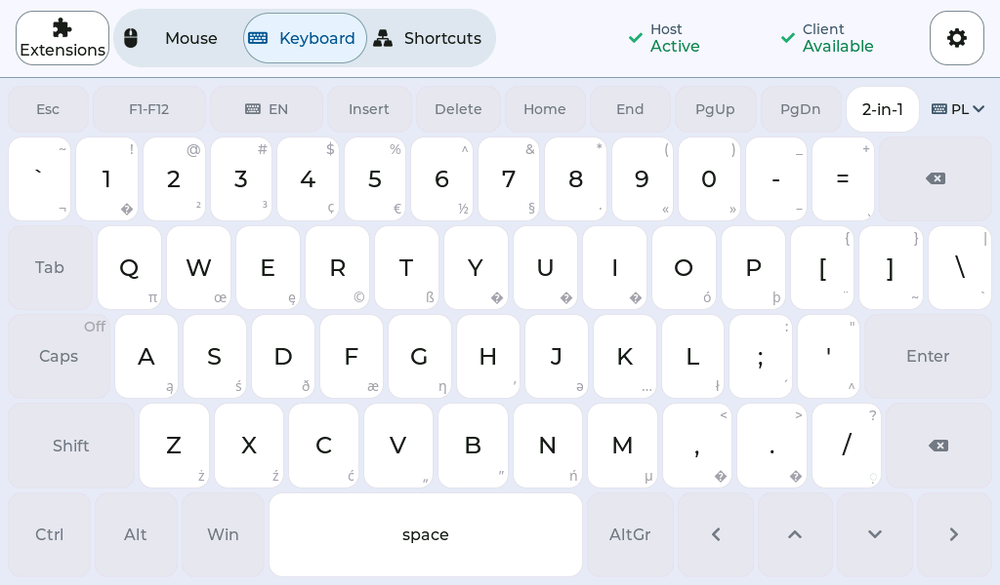
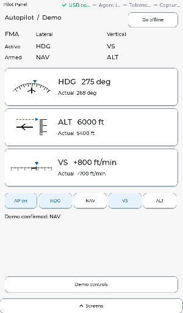

# KVMpad

KVMpad turns the **Waveshare ESP32-S3-Touch-LCD-7B** into a touchscreen keyboard and touchpad. Plug its native USB port into the computer you want to control. Type on the 7-inch screen or send input over Wi-Fi from another PC using the Windows CLIENT or SSH.

## Screen gallery

Captured on the board in the Day theme. The portrait autopilot is running in Demo mode.



| Touchpad above the keyboard | Full keyboard |
| --- | --- |
| [](docs/images/day-hybrid.png) | [](docs/images/day-keyboard.png) |
| **System shortcuts** | **Extensions menu** |
| [](docs/images/day-shortcuts.png) | [](docs/images/day-extensions.png) |
| **Checklist extension** | **Pilot Panel autopilot** |
| [](docs/images/day-checklist.png) | [](docs/images/pilot-autopilot-lcd.png) |

## Use the touchscreen

With the board connected, open **Mouse** to move the pointer, click or scroll. The hybrid keyboard keeps the touchpad within reach while you type. Place it above the keys, on the left or on the right. Hold a finger past the edge of the pad to keep the pointer moving. For a different theme or backlight level, open **Settings → Appearance**.

## Control another computer

**Operator PC → Wi-Fi → KVMpad → USB → target computer**

The **operator PC** is the computer you sit at. The **target** is the computer plugged into KVMpad. Its built-in USB keyboard and mouse drivers handle remote input, so there is nothing to install on the target.

1. Enable remote access on KVMpad. Tap **Pair a client**.
2. Open **KVMpad CLIENT** on the operator PC. Select **Discover → Pair**. Enter the six-digit PIN in CLIENT.
3. Confirm the pairing on the KVMpad touchscreen.
4. Select **Connect → Host input** in CLIENT to send keystrokes, mouse movements or shortcuts. [Windows CLIENT guide](clients/windows/README.md)

The **SSH server** runs on KVMpad. It translates commands such as `mouse move 20 0` into USB input for the target. [Command syntax](components/ssh_control/include/ssh_control.h)

1. Select **Host input → SSH command…** in the paired CLIENT.
2. Select your public key. Run the generated command on the operator PC.
3. Approve control on the KVMpad touchscreen. Keep CLIENT connected during the SSH session. [SSH setup](clients/windows/README.md#direct-ssh-input)

## What can I see on the KVMpad screen?

**Cursor Magnifier.** Open the extension on KVMpad. The Windows CLIENT starts **KVMpad HOST** on the PC that runs CLIENT. Select a monitor on that PC. Confirm the selection on KVMpad. HOST sends the area around the pointer to KVMpad over Wi-Fi.

If CLIENT runs on the operator PC, the image comes from the operator PC. To magnify the target computer's desktop, run CLIENT and HOST on that Windows computer. [Cursor Magnifier setup](hosts/windows/README.md)

**An extra USB display (experimental).** The target computer can send a desktop to KVMpad through its USB display driver. The portrait USB Monitor Console combines that desktop with a keyboard and touchpad. Linux requires the GUD driver and manual device setup. The external Windows driver fails signature verification. This feature requires a running operating system. [USB compatibility](docs/COMPATIBILITY.md)

**A video from microSD.** Play H.264 clips under **Extensions → Video files**. Playback runs on the board. The Windows CLIENT can prepare clips that exceed the decoder’s available memory. [Prepare a video](clients/windows/README.md#prepare-an-h264-video-for-offline-playback)

## Extensions

Install extensions from a FAT32 or exFAT microSD card using **Extensions → Install from card**. Review the permissions on the touchscreen. In a multi-screen extension, swipe up from the bottom edge to choose another screen or return Home.

**Pilot Panel** includes an offline kneeboard for charts and checklists, plus radio, transponder and autopilot demos. To build your own extension, open **Tools → Extension Studio** in the Windows CLIENT. [Pilot Panel](extensions/pilot-panel/) · [Extension SDK tutorial](tools/extension_sdk/README.md) · [Example packages](tools/kvmpack/examples/)

## Build and development

The 7B runs one firmware image with every target computer. It has a 1024 × 600 display, 16 MiB of flash and 8 MiB of PSRAM. Use the **USB-UART** connector for the development console. [Board details](hardware/boards.md)

- [Build the 7B firmware](docs/HANDBOOK.md#build-the-7b-firmware) with ESP-IDF v6.1, the Xtensa H.264 decoder and an OTA signing key.
- [Run the desktop simulator](simulator/README.md) to try the touchscreen layouts on a computer.
- See the [contribution guide](CONTRIBUTING.md) for the repository layout and test instructions.

## License

KVMpad is source-available under the [PolyForm Noncommercial License 1.0.0](LICENSE.md). Commercial use requires a separate license from the author. Bundled third-party components retain their own licenses. [Third-party notices](THIRD_PARTY_NOTICES.md)

```text
Required Notice: Copyright 2026 D-Ogi (https://github.com/D-Ogi/esp32-s3-kvmpad)
```
