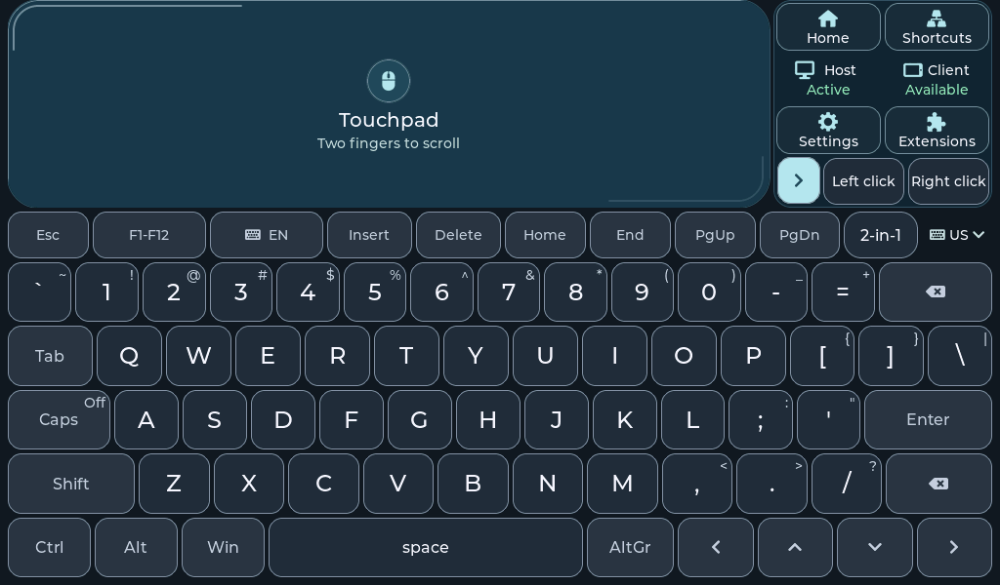
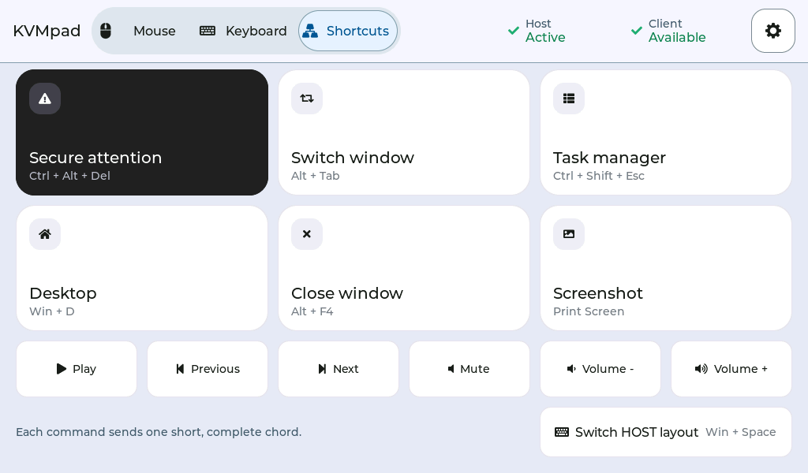
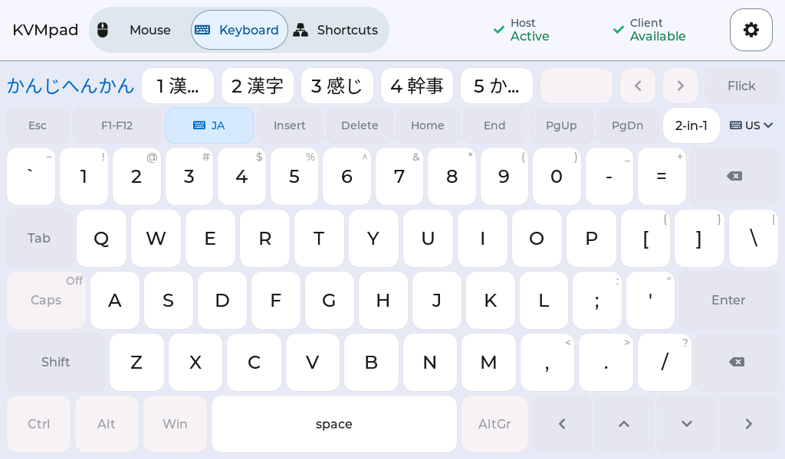
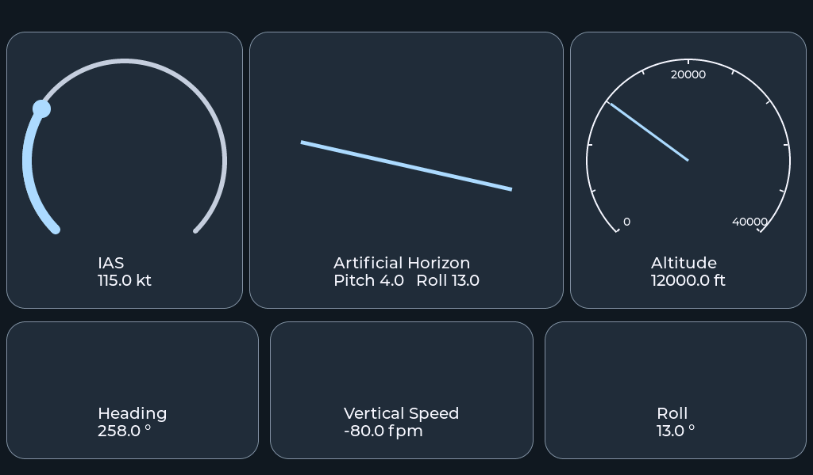
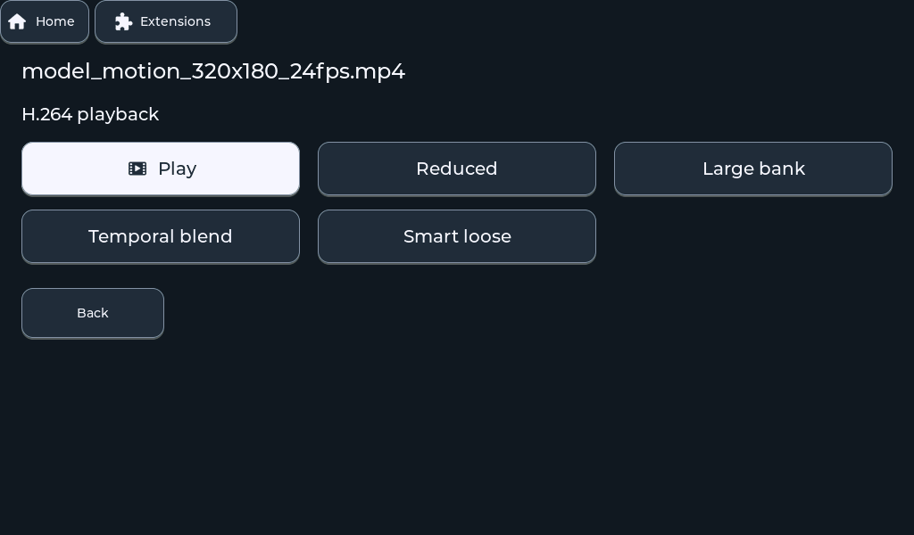
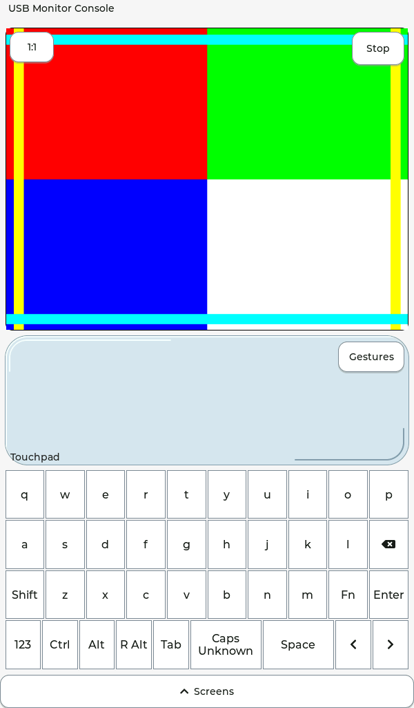
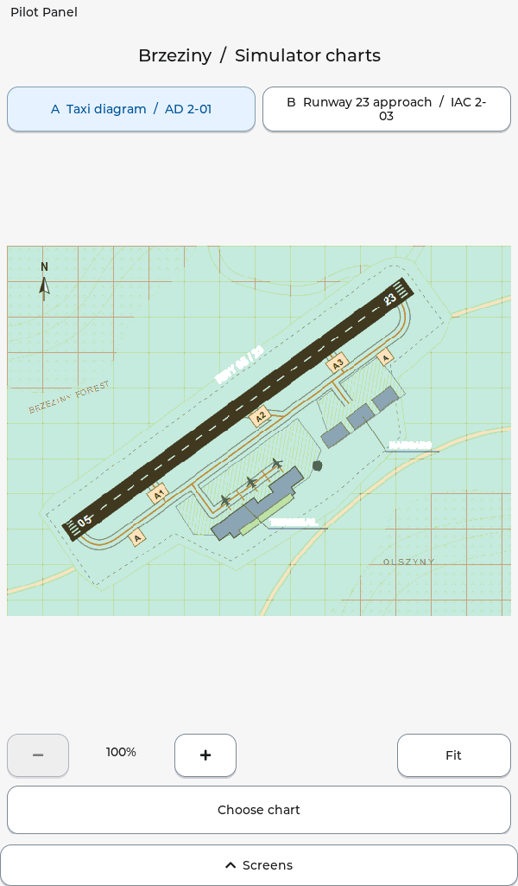
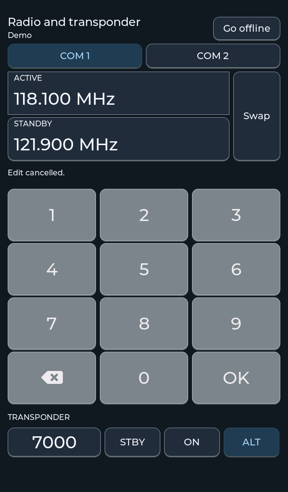

# KVMpad

KVMpad lets you control a computer from a **Waveshare ESP32-S3-Touch-LCD-7B** or from another PC on the network. The board plugs into the target computer as a USB keyboard and mouse. You can type and scroll on its touchscreen or send input from the paired Windows CLIENT. Its 7-inch LCD can also show a magnified area of a Windows monitor or act as an extended desktop.



*The 1024 × 600 hybrid keyboard rendered by the project's LVGL simulator.*

## Control a computer remotely

Connect the board's native USB port to the **target computer**. On the **operator PC**, open KVMpad CLIENT. Enable remote access on the board, tap **Pair a client**, then choose **Discover → Pair** on the PC. Enter the six-digit PIN and approve it on the LCD. In the CLIENT, choose **Connect → Host input** and request control. You can then capture keyboard and mouse input, send a shortcut, or type text on the target. [Windows CLIENT guide](clients/windows/README.md)

| What you want to do | Signal path and requirements |
| --- | --- |
| Send keys and mouse movements | Operator PC → encrypted WebSocket (WSS) over Wi-Fi → KVMpad → USB HID → target. The target receives ordinary keyboard and mouse reports without a KVMpad application running on it. |
| Use SSH | SSH access to a running target uses that computer's own SSH service. KVMpad firmware has no SSH login. Its development console is on USB-UART. |
| Operate a BIOS or UEFI setup screen | The board exposes a USB Boot Keyboard and Boot Mouse. Physical UEFI input testing is still pending. The 7B also **receives video over USB**. On the tested system the Windows display driver produces those frames after the OS starts. No pre-boot sender or return stream to the operator CLIENT has been verified. Viewing POST remotely on an ordinary target requires an independent source such as HDMI capture or a management controller with remote console support. [USB HID test status](components/usb_hid_device/README.md) · [USB video transport](docs/ADR/ADR-043-usb-extended-display.md) |
| View a running Windows desktop on the board | The Windows HOST companion sends an approved monitor region to Cursor Magnifier on the LCD. For a separate desktop, the Espressif USB display driver sends an extended Windows desktop to the board over USB. [HOST capture guide](hosts/windows/README.md) · [USB monitor guide](components/usb_monitor/README.md) |

## What works today

| Use case | How it works |
| --- | --- |
| Keyboard and mouse | Local USB input works offline. Place the touchpad above the keyboard or beside it on either side. In the top layout you can move the controls to the left or right. Day, Night, High contrast and backlight settings are under **Settings → Appearance**. |
| Windows remote control | Subsequent connections verify the saved device certificate. The HOST companion reuses the same pairing for extensions that need access to the PC. [CLIENT setup](clients/windows/README.md) |
| USB monitor | With the USB monitor firmware profile and the signed driver distributed by Espressif, Windows can extend its desktop onto the board. Use **Extensions → USB monitor** for a standalone screen, or open **USB Monitor Console** to keep local input alongside the desktop. [Monitor setup and driver](components/usb_monitor/README.md) · [Portrait console](extensions/usb-monitor-console/) |
| Live magnifier | Cursor Magnifier shows the area around the pointer on a Windows monitor. Choose the monitor in the Windows picker and approve it on the board. The HOST supports JPEG, Cinepak and H.264. [Capture setup and codec requirements](hosts/windows/README.md) |
| Offline video | The media firmware plays H.264 video from microSD. The Windows CLIENT can prepare companion files for clips that exceed the board's decoder memory. Open **Extensions → Video files** on the board to select a clip. [Card preparation](clients/windows/README.md#prepare-an-h264-video-for-offline-playback) |
| Extensions | Install a package from a FAT32 or exFAT microSD card and review its permissions on the LCD. Swipe up from the bottom of a multi-screen extension to switch screens or return Home. Pilot Panel includes an offline kneeboard with charts and checklists, plus radio, transponder and autopilot demos. [Pilot Panel](extensions/pilot-panel/) · [Extension examples](tools/kvmpack/examples/) |

## Screen gallery

The landscape views below come from the native LVGL simulator. Open an image to inspect its labels at full size.

| System shortcuts | Japanese keyboard |
| --- | --- |
| [](simulator/golden/shortcuts.png) | [](simulator/golden/keyboard_ja.png) |
| **Flight instruments** | **Card video player** |
| [](docs/images/flight-instruments.png) | [](docs/images/card-video.png) |

### Portrait console and Pilot Panel

| USB Monitor Console | Pilot kneeboard |
| --- | --- |
| [](docs/images/usb-console.png) | [](docs/images/pilot-kneeboard.png) |
| LVGL simulator with a test pattern in the USB viewport. | LVGL simulator with the bundled airfield chart. |
| **Radio and transponder** | **Autopilot** |
| [](docs/images/pilot-radio.png) | [](docs/images/pilot-autopilot-lcd.png) |
| LVGL simulator in the Night theme. | Captured from the physical 7B LCD framebuffer in Demo mode. |

## Hardware and development status

The development board has a **1024 × 600 RGB565 panel**, a five-point GT911 touch controller, 16 MiB of flash and 8 MiB of PSRAM. Use the **native USB** connector for keyboard, mouse and display traffic. The separate **USB-UART** connector provides the development console. The original 800 × 480 specification predates the change to the 7B. [Measured board record](hardware/boards.md) · [Board selection decision](docs/ADR/ADR-026-target-board-7b.md)

The firmware runs on the physical 7B. Hardware trials include typing into Windows while the portrait console displayed the desktop, returning to the regular HID interfaces on exit, and playing all 73 frames of a prepared 1080p H.264 test clip. Playback speed depends on the clip and playback mode. [Console trials](docs/ADR/ADR-046-portrait-monitor-console.md) · [Media measurements](test/reports/2026-11-19_device-media_022168e4.yaml)

The USB monitor is still under development. The board has displayed a Windows extended desktop at 640 × 480 and received a native 1024 × 600 signal. The standalone monitor menu offers **Choose in Windows** alongside the two fixed sizes. Windows enumerated 17 resolutions during a driver trial. Switching between those resolutions in Windows Settings while the board continues to display the desktop still needs end-to-end hardware verification. Display latency remains an active area of work. [USB display trials](docs/ADR/ADR-043-usb-extended-display.md) · [Roadmap](docs/ROADMAP.md)

## Getting started

- **Try the UI on a computer.** The desktop simulator runs the firmware's LVGL views and includes reproducible touch and keyboard scenarios. [Simulator build and run instructions](simulator/README.md)
- **Connect a flashed board.** Start with the native USB port for local input. To control it over Wi-Fi, enable remote access on the board, choose **Pair a client**, then **Discover → Pair** in the Windows CLIENT. [Windows CLIENT build and pairing](clients/windows/README.md) · [HOST setup](hosts/windows/README.md)
- **Create an extension.** Open **Tools → Extension Studio** in the Windows CLIENT, or run `py -3 tools/kvmpack/kvmpack.py studio` from the repository root with Python, Tk, Pillow and jsonschema installed. The SDK guide walks through building a checklist, previewing it and staging it for the card. [Extension SDK guide](tools/extension_sdk/README.md) · [Widget bindings](docs/EXTENSION-BINDINGS.md)
- **Build the firmware.** The project uses ESP-IDF v6.1, FreeRTOS, LVGL 9.6 and TinyUSB. The media and USB monitor configurations are separate from the base defaults. For a USB monitor build, apply the defaults in the order listed in the monitor profile. The OTA guide covers the signing key and first wired installation. [Pinned dependencies](dependencies.lock) · [USB monitor build profile](sdkconfig.usb-monitor-eval) · [Signed firmware setup](docs/OTA.md)

## Project documentation

The [v1.1.0 specification](docs/spec/README.md) records the original requirements. Later hardware and product decisions are in the [architecture decision records](docs/ADR/README.md). The [hardware handbook](docs/HANDBOOK.md) and [test reports](test/reports/) document board behavior and the conditions of each measurement.

## Contributing

See the [contribution guide](CONTRIBUTING.md) for the repository layout, development workflow and test requirements. Report simulator and hardware results separately.

## License

KVMpad is source-available under the [PolyForm Noncommercial License 1.0.0](LICENSE.md). Commercial use requires a separate license from the author. Bundled third-party components retain their own licenses. [Third-party notices](THIRD_PARTY_NOTICES.md)

```text
Required Notice: Copyright 2026 D-Ogi (https://github.com/D-Ogi/esp32-s3-kvmpad)
```
