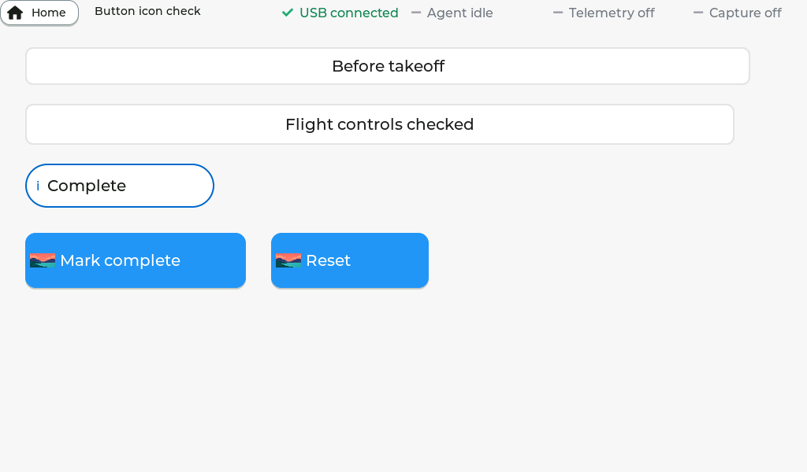

# KVMpad

KVMpad lets you control a computer from a **Waveshare ESP32-S3-Touch-LCD-7B** or from another PC on the network. The board plugs into the target computer as a USB keyboard and mouse. You can type and scroll on its touchscreen or send input from the paired Windows CLIENT. Its 7-inch LCD can also show a magnified area of a Windows monitor from the paired HOST. Extended desktop over USB remains experimental.

## Screen gallery

These Day-theme screenshots come from the physical 7B framebuffer. The autopilot shows Pilot Panel's Demo mode. Open any image to see the captured detail.


| Touchpad above the keyboard | Full keyboard |
| --- | --- |
| [](docs/images/day-hybrid.png) | [](docs/images/day-keyboard.png) |
| **System shortcuts** | **Extensions menu** |
| [](docs/images/day-shortcuts.png) | [](docs/images/day-extensions.png) |
| **Checklist extension** | **Pilot Panel autopilot** |
| [](docs/images/day-checklist.png) | [](docs/images/pilot-autopilot-lcd.png) |

## Control a computer remotely

Connect the board's native USB port to the **target computer**. On the **operator PC**, open KVMpad CLIENT. Enable remote access on the board, tap **Pair a client**, then choose **Discover → Pair** on the PC. Enter the six-digit PIN and approve it on the LCD. In the CLIENT, choose **Connect → Host input** and request control. You can then capture keyboard and mouse input, send a shortcut, or type text on the target. [Windows CLIENT guide](clients/windows/README.md)

| What you want to do | Signal path and requirements |
| --- | --- |
| Send keys and mouse movements | Operator PC → encrypted WebSocket (WSS) over Wi-Fi → KVMpad → USB HID → target. The target receives ordinary keyboard and mouse reports without a KVMpad application running on it. |
| Control the target through SSH to KVMpad | The optional SSH firmware profile accepts keyboard and mouse commands from OpenSSH. In a connected Windows CLIENT, choose **Host input → SSH command…** to bind your public key to the existing pairing. Approve control on the device. The default firmware profile supports remote input through CLIENT and leaves SSH disabled. [Operator guide](clients/windows/README.md) · [Command syntax](components/ssh_control/include/ssh_control.h) |
| Operate a BIOS or UEFI setup screen | The 7B exposes a USB Boot Keyboard and Boot Mouse. Physical UEFI input testing is pending. Live Setup video over the board's native USB port would require compatible graphics support in the target firmware. Live UEFI graphics over this cable have not been demonstrated on a physical PC. [USB HID test status](components/usb_hid_device/README.md) · [Preboot USB graphics](docs/COMPATIBILITY.md) |
| View a running Windows desktop on the board | The Windows HOST companion sends an approved monitor region to Cursor Magnifier on the LCD. The separate USB desktop was demonstrated with an external driver that failed signature verification. [HOST capture guide](hosts/windows/README.md) · [USB monitor guide](components/usb_monitor/README.md) |

## What works today

On the 7B, open **Extensions → USB monitor → Monochrome / Linux GUD** to use the experimental Linux monitor. **Home** returns the USB port to its keyboard and mouse profile. The board displayed an independent 640×480 monochrome X11 desktop, and Linux switched to 800×600 and back while connected. Separate tests verified pre-login console output with keyboard and mouse on the same cable, and a moving VGA pattern at 2 Hz. The Linux guest used its distribution's GUD driver with a manually registered test device ID. Automatic monitor discovery on stock Linux remains open. [Linux monitor qualification](components/usb_monitor/README.md)

| Use case | How it works |
| --- | --- |
| Keyboard and mouse | Local USB input works offline. Place the touchpad above the keyboard or beside it on either side. In the top layout you can move the controls to the left or right. Day, Night, High contrast and backlight settings are under **Settings → Appearance**. |
| Windows remote control | Subsequent connections verify the saved device certificate. The HOST companion reuses the same pairing for extensions that need access to the PC. [CLIENT setup](clients/windows/README.md) |
| USB monitor | The standalone screen and portrait console are experimental. KVMpad does not recommend installing the tested Windows graphics package (xfz1986 1.2.25.2). Windows keyboard and mouse input uses Microsoft's built-in drivers. [Driver verification](docs/COMPATIBILITY.md) · [Portrait console](extensions/usb-monitor-console/) |
| Live magnifier | Cursor Magnifier shows the area around the pointer on a Windows monitor. Choose the monitor in the Windows picker and approve it on the board. The HOST supports JPEG, Cinepak and H.264. [Capture setup and codec requirements](hosts/windows/README.md) |
| Offline video | The media firmware plays H.264 video from microSD. The Windows CLIENT can prepare companion files for clips that exceed the board's decoder memory. Open **Extensions → Video files** on the board to select a clip. [Card preparation](clients/windows/README.md#prepare-an-h264-video-for-offline-playback) |
| Extensions | Install a package from a FAT32 or exFAT microSD card and review its permissions on the LCD. Swipe up from the bottom of a multi-screen extension to switch screens or return Home. Pilot Panel includes an offline kneeboard with charts and checklists, plus radio, transponder and autopilot demos. [Pilot Panel](extensions/pilot-panel/) · [Extension examples](tools/kvmpack/examples/) |

On the Mouse screen, hold the ridged wheel above or below center to scroll. For continuous pointer movement in Mouse, a hybrid keyboard or USB Console, slide a finger from the touchpad past its edge and hold. Move back onto the pad for ordinary pointer control.

## Hardware and development status

The development board has a **1024 × 600 RGB565 panel**, a five-point GT911 touch controller, 16 MiB of flash and 8 MiB of PSRAM. Use the **native USB** connector for keyboard, mouse and display traffic. The separate **USB-UART** connector provides the development console. The original 800 × 480 specification predates the change to the 7B. [Measured board record](hardware/boards.md)

The firmware runs on the physical 7B. Hardware trials include typing into Windows while the portrait console displayed the desktop, returning to the regular HID interfaces on exit, and playing all 73 frames of a prepared 1080p H.264 test clip. Playback speed depends on the clip and playback mode. [USB Monitor Console](extensions/usb-monitor-console/) · [Video preparation](clients/windows/README.md#prepare-an-h264-video-for-offline-playback)

Windows displayed test images on the 7B at **640 × 480** and **1024 × 600** using the external driver. On one switch back to VGA, Windows restarted the driver and restored the previous resolution. The two fixed-size choices are available on the LCD. [USB compatibility](docs/COMPATIBILITY.md)

## Getting started

- **Try the UI on a computer.** The desktop simulator runs the firmware's LVGL views and includes reproducible touch and keyboard scenarios. [Simulator build and run instructions](simulator/README.md)
- **Connect a flashed board.** Start with the native USB port for local input. To control it over Wi-Fi, enable remote access on the board, choose **Pair a client**, then **Discover → Pair** in the Windows CLIENT. [Windows CLIENT build and pairing](clients/windows/README.md) · [HOST setup](hosts/windows/README.md)
- **Create an extension.** Open **Tools → Extension Studio** in the Windows CLIENT, or run `py -3 tools/kvmpack/kvmpack.py studio` from the repository root with Python, Tk, Pillow and jsonschema installed. The SDK guide walks through building a checklist, previewing it and staging it for the card. [Extension SDK guide](tools/extension_sdk/README.md) · [Widget bindings](docs/EXTENSION-BINDINGS.md)
- **Build the firmware.** With ESP-IDF v6.1 and a fresh configuration, `idf.py build` selects the boot keyboard and mouse. Open **Extensions → USB monitor** on the LCD to start a display session. The combined media and SSH build keeps the same startup interfaces and adds H.264 playback and paired SSH commands. [Combined build instructions](docs/HANDBOOK.md#combined-media-and-ssh-build) · [USB profiles](docs/HANDBOOK.md#usb-startup-and-display-profiles) · [Signed firmware setup](docs/OTA.md)

## Project documentation

See the [7B firmware handbook](docs/HANDBOOK.md), [USB compatibility table](docs/COMPATIBILITY.md) and [extension guide](docs/EXTENSIONS.md). The [protocol specification](docs/spec/03-CONTRACTS-AND-PROTOCOLS.md) describes the original wire contracts.

## Contributing

See the [contribution guide](CONTRIBUTING.md) for the repository layout, development workflow and test requirements. Report simulator and hardware results separately.

## License

KVMpad is source-available under the [PolyForm Noncommercial License 1.0.0](LICENSE.md). Commercial use requires a separate license from the author. Bundled third-party components retain their own licenses. [Third-party notices](THIRD_PARTY_NOTICES.md)

```text
Required Notice: Copyright 2026 D-Ogi (https://github.com/D-Ogi/esp32-s3-kvmpad)
```
